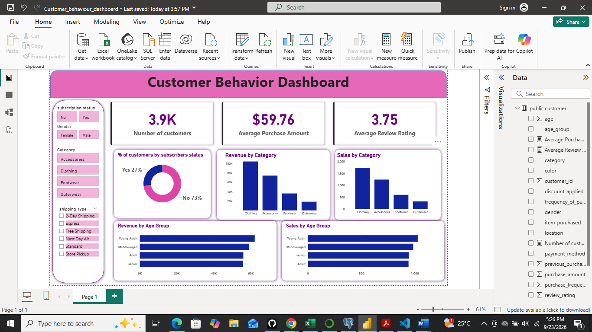
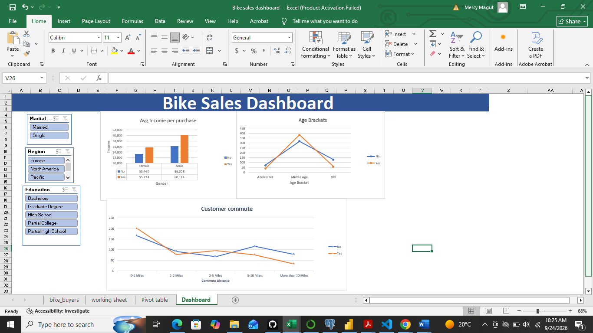
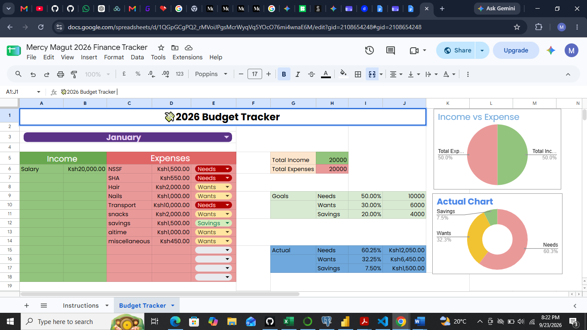

I turn complex transactional data, financial metrics, and customer behavior into clear insights, interactive dashboards, and actionable business strategies.

📧 [mjepkorir69@gmail.com](mailto:mjepkorir69@gmail.com) · 💻 [GitHub](https://github.com/mmagut5) · 🌐 [Google Sites Portfolio](https://sites.google.com/view/mercymagut/home)

---

## About Me

I'm a finance and data analytics professional with a B.Sc. in Financial Engineering and hands-on experience in financial analysis, credit monitoring, and reconciliation. I specialize in exploratory data analysis, database modeling, and interactive visual reporting, with a focus on financial trends, customer behavior, and operational performance, so organizations can optimize strategy, reduce risk, and grow revenue.

## Tools & Skills

| Area | Tools / Skills |
|---|---|
| Programming & Databases | Python (pandas), SQL, PostgreSQL, MySQL, Jupyter Notebooks |
| Data Analysis | Data Cleaning, EDA, Statistical Analysis, Forecasting, Data Modeling |
| Visualization & Reporting | Power BI, Excel (Pivot Tables, Pivot Charts), Dashboard Development, Financial Reporting |
| Accounting & Finance Tools | QuickBooks, Invoicing, Reconciliation, Accounts Receivable |
| Finance & Risk | Financial Analysis, Financial Modeling, Credit Analysis, Credit Risk Monitoring, Loan Portfolio Analysis, Risk Analysis |

---

## Featured Projects

### 1. Unlocking Retail Growth: Customer Behavior Analysis Dashboard
Transforming consumer data into targeted marketing and retention strategies.

- Cleaned and prepared **3,900 purchase records** using Python (pandas)
- Ran analysis queries in **PostgreSQL**
- Built an interactive **Power BI** dashboard to surface customer segments, buying patterns, and retention opportunities
- **Tech:** Python · PostgreSQL · Power BI
- 📄 [Read the full report](https://drive.google.com/open?id=1rH0tacD8z2b6nsejMZgjnKb9wlvqxTeoJ-XycNSBhgw)
- 🔗 [GitHub repo](https://github.com/mmagut5/customer_behavior-_analysis)

### 2. Bike Sales Dashboard Analysis
An interactive Excel dashboard built with Pivot Tables and Pivot Charts to analyze bike purchase patterns across customer demographics: income, age, gender, education, marital status, region, and commute distance.

- Identified purchasing patterns and generated data-driven customer insights
- **Tech:** Microsoft Excel (Pivot Tables, Pivot Charts)
- 📄 [Read the report](https://drive.google.com/open?id=1Su3sWF_RuLxenMPZuLyBsoh5tW5dwjYKWuWdl2s3lhY)

### 3. Personal Finance & Budget Tracker (50/30/20 Framework)
A dynamic Google Sheets tracker built around the 50/30/20 budgeting rule.

- Tracks income and expenses with dropdown-based categorization
- Automatically calculates target vs. actual ratios
- Visualizes cash flow distribution with real-time charts
- **Tech:** Google Sheets
- 📄 [View the tracker](https://drive.google.com/open?id=1QGpGCgPQ2_rMVoiJPgsMcrWyqVq5YOcO76mi4wnaE6M)

### 4. Layoffs Data Cleaning & Exploratory Data Analysis (SQL)
Cleaned and explored a global layoffs dataset in MySQL: removing duplicates, standardizing data, handling null values, and running EDA to uncover trends across companies, industries, and time.

- **Tech:** MySQL
- 🔗 [GitHub repo](https://github.com/mmagut5/Layoffs_data_analysis_sql-))

---

## WORK EXPERIENCE

Finance and Accounts Intern | Sosiani Flowers | Eldoret, Kenya | June 2026 – September 2026
- Recorded and maintained financial transactions, customer invoices, and sales records in QuickBooks, ensuring accurate bookkeeping and accounts receivable records
- Reconciled sales data from the Flower Meister International system against QuickBooks and supporting documents, identifying and resolving discrepancies to improve data accuracy
- Prepared and issued customer invoices, verifying billing details against sales records and supporting documentation
- Supported month-end style reconciliation of sales records to invoices to ensure completeness and accuracy of financial information
- Prepared and submitted export permit applications using export documentation, following up with clearing agents to obtain export entries
- Coordinated with Finance, Logistics, and Export departments and external stakeholders to support timely order processing and export shipments

Finance Intern | Uwezo Fund Oversight Board (Public Service Internship Program) | Nairobi, Kenya | March 2025 – March 2026
- Analyzed loan disbursement and repayment data to assess loan portfolio performance and identify default risk trends
- Supported credit monitoring by tracking borrower behavior, repayment patterns, and compliance with funding guidelines
- Prepared financial reports and summaries to support decision-making on fund allocation and risk management
- Cleaned and analyzed financial data in Excel to improve the accuracy and reliability of records
- Evaluated financial performance across constituencies, highlighting inefficiencies and recommending improvement opportunities
- Collaborated with cross-functional teams to ensure proper documentation, reporting, and accountability of funds

  
---

## Education & Certifications

- **B.Sc. Financial Engineering**: Jomo Kenyatta University
- **Data Analytics**: ALX Africa (Python, SQL, Data Visualization, Business Analytics)
- **Certified Investment Financial Analyst**: KASNEB Level 2

---

## Let's Connect

I'm open to Data Analyst and Financial/Credit/Risk Analyst opportunities.

📧 mjepkorir69@gmail.com · 💻 [github.com/mmagut5](https://github.com/mmagut5)
